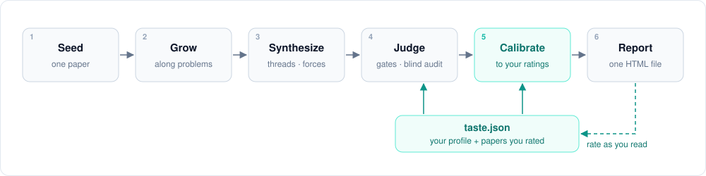
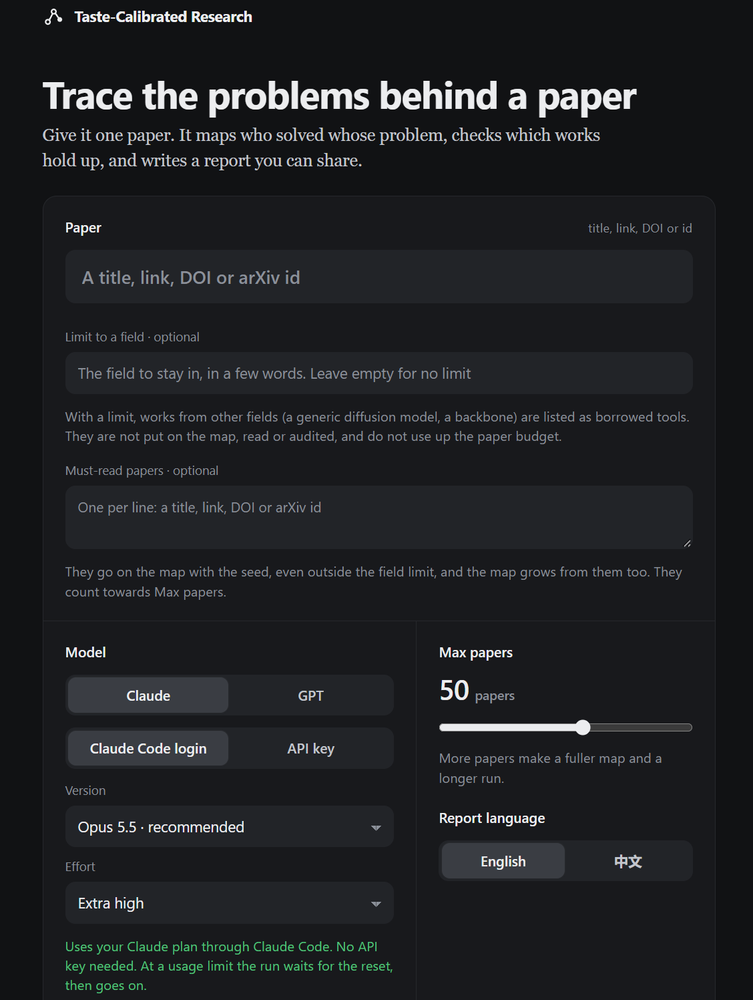
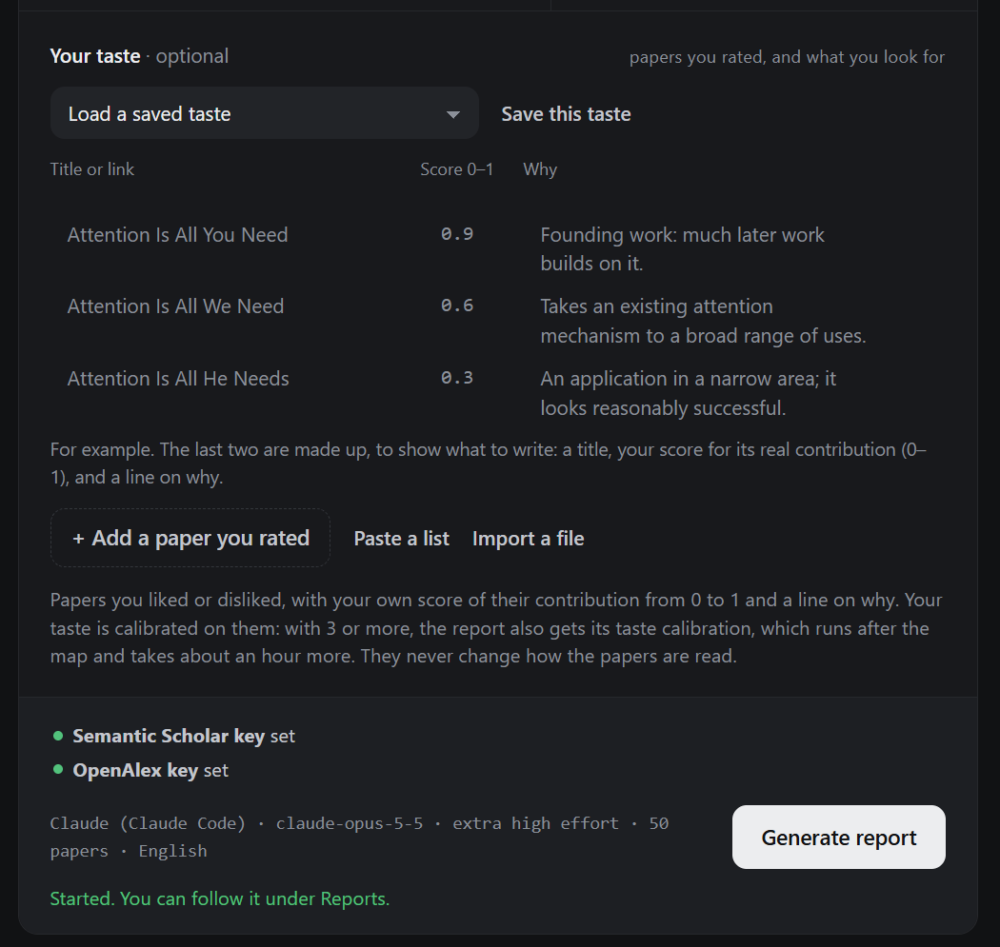
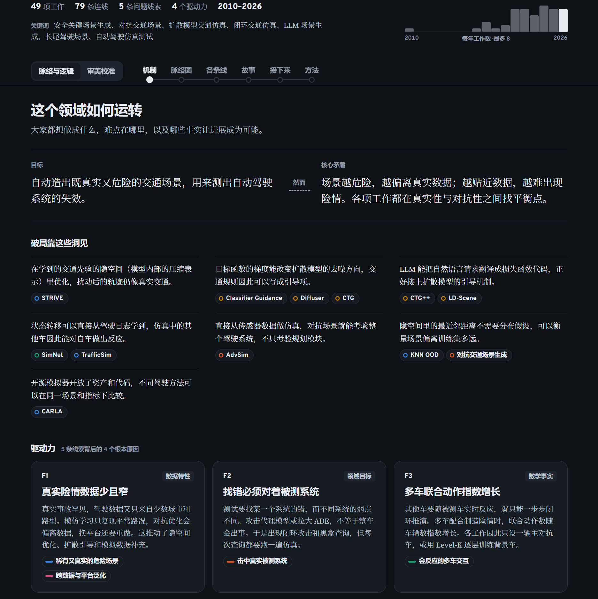
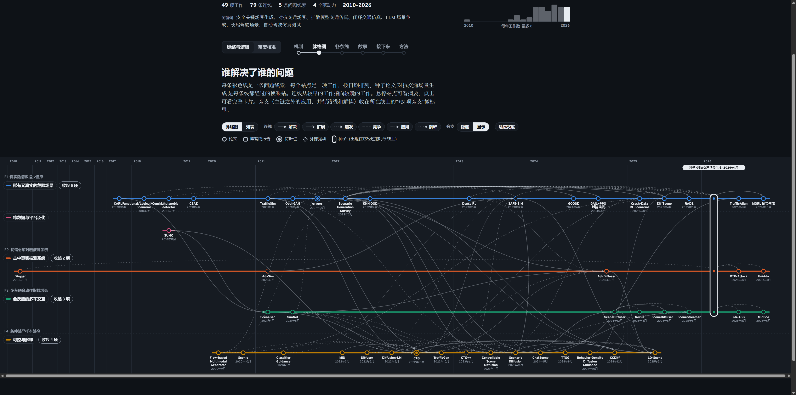
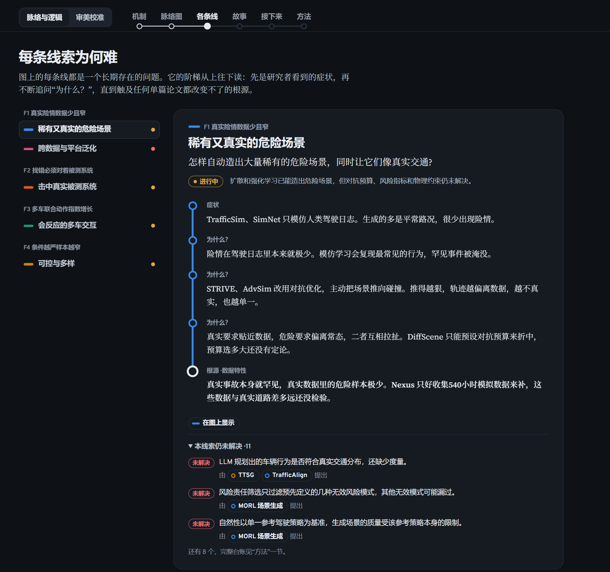
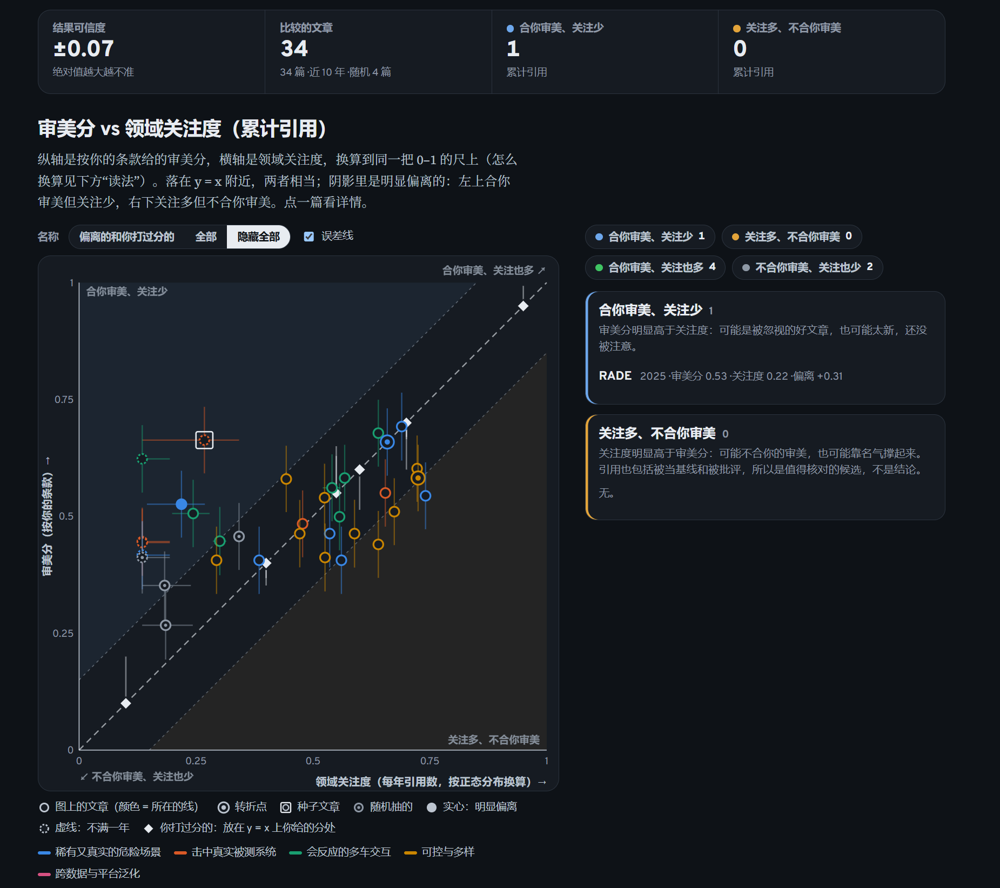

# Taste-Calibrated Research

Give it one paper. It maps the line of work around that paper and judges each work by what it delivers, not by its venue or citation count. It then calibrates that judgement against papers you have read and rated.



## Setup

You need Python 3.9 or newer and no extra packages. Runs bill your Claude or ChatGPT subscription through the official CLI, not an API key.

1. Sign in once with Claude Code (`claude`, then `/login`) or with Codex (`npm i -g @openai/codex`, then `codex login`).
2. Get a free [Semantic Scholar key](https://www.semanticscholar.org/product/api#api-key-form) and set it: `export S2_API_KEY=...` (macOS, Linux) or `setx S2_API_KEY "..."` (Windows; read from then on, also in windows that were already open). Without a key, most searches are refused. For `fit`, a free [OpenAlex key](https://openalex.org/settings/api) (`OPENALEX_API_KEY`) is advised too: without one OpenAlex allows only a small daily amount.
3. Optional but recommended: let the tool read full-text PDFs: `brew install poppler` on a Mac, `pip install pypdf` on Windows or Linux. Without one, papers that are not on arXiv as HTML can only be read from their abstract, and are marked *not read in full*.
4. Run `python3 -m tastecal doctor` to check the setup.

## Use it

`python3 -m tastecal serve` opens a local page (on this computer only).



1. **Paper**: a title, link, DOI or arXiv id. The map grows from it.
2. **Limit to a field** (optional): works from other fields, such as a generic diffusion model or a backbone, are listed as borrowed tools instead of being mapped.
3. **Must-read papers** (optional): papers you want on the map whatever happens. The map grows from them too.
4. **Model** and **effort**: your Claude Code or ChatGPT login. Opus 5.5 at high or extra high effort works well.
5. **Max papers** and **report language**: 30 to 50 papers; English or Chinese.



6. **Your taste** (optional): papers you rated, each with your score of its real contribution from 0 to 1 and a line on why. They need not come from the seed's field. *Load a saved taste* also lists the ratings files in the project folder (`ratings*.json` and the like); *Paste a list* and *Import a file* add more; *Save this taste* keeps them in `taste.json`. The three rows shown while the list is empty are examples (two made-up titles) and are never sent.
7. The dots at the bottom show whether the free Semantic Scholar and OpenAlex keys are set (see Setup).
8. **Generate report.** A 50-paper run at extra high effort takes a few hours. With 3 or more rated papers, the taste calibration follows and adds about an hour. Follow the run under *Reports* on the same page. A run that stopped can be resumed there; nothing it already did is paid for again.

## Read the report

`report.html` has two parts, switched at the top left: **Lineage and logic**, and **Taste calibration**. The screenshots show a report written in Chinese (`--language zh-CN`) on adversarial traffic-scene generation; its parts are called 脉络与逻辑 and 审美校准.



**Mechanism.** The field's goal, and the core tension every work moves along (here: the more dangerous a scene, the further it is from real data). Below them, the insights that made progress possible, each with the works that brought it, and the driving forces (F1, F2, …): root causes no single paper can change, each with its kind (data, the field's goal, a mathematical fact, hardware, economics) and the threads it drives. The top line counts works, links, threads and forces; the bars show works per year.



**Map.** Each coloured line is a problem thread and each station a work, placed by date. The seed is the tall interchange every line passes through. Links run from earlier to later work and say what kind they are: resolves, extends, inspired, competes, applies, explains (challenges in red). Side branches are folded into the "+N" badge on their line; *Show* unfolds them. Hover a station for a summary; click it for its card: what it inherits, its move, its key insight, what it leaves open, and the works before and after it. *List* shows the same works as a table.



**Threads.** The threads, grouped by driving force. Pick one to read its why-ladder from the top: the symptom researchers saw, then "why?" asked until the answer reaches a root. Below it are the problems on that thread still open, with the works that raised them. **Story** tells the field as a narrative for a newcomer. **What's next** lists who is working on what in the last year, the open questions with the experiment that would settle each, and the assumptions most works share. **Method** shows how the map was grown, round by round, and the full problem ledger.



**Taste calibration.** Read the four numbers first:

- **Trust in the result** (±0.07 here): how far your clauses miss your own scores (root mean square). The smaller, the more the chart can be trusted. It is also added to every paper's bar.
- **Papers compared**: the method papers on the map from the last ten years, plus a few drawn at random from recent work citing them, so the comparison is not only among well-cited work.
- **To your taste, little attention** and **much attention, not to your taste**: how many papers are clearly off the line on each side.

Up is the taste score your clauses give a paper; across is the field's attention, its citations a year put on the same 0–1 scale (the median paper of the run at 0.5, Attention Is All You Need at the top). On the dashed line y = x the two agree. A paper in a shaded corner is off the line by more than its two bars. Top left: high on your clauses but little cited, which means overlooked, or too new to be noticed. Bottom right: much cited but low on your clauses; citations include use as a baseline and criticism, so treat these as papers to check, not a verdict. Hollow points are papers on the map, coloured by thread; a dot inside marks a turning point, the square is the seed, grey points were drawn at random, a filled point is off the line, and a dashed one is under a year old (never counted as off). Diamonds are your rated papers, placed at your own score. Click any point for its card: its score and range, every measure of attention, and for each clause the level it got, the passage that earned it, and what it lacks for the next level.

The other tabs: **Papers** (every paper in one sortable table, with filters and a search), **Attention measures** (the same chart for recent citations, influential citations and GitHub stars), **Clauses** (each clause with its six levels, its reading notes and its share of the score) and **How it was fitted** (how closely your scores are reproduced, what each round changed, which papers to rate next, and which papers were not scored and why, with the file name each missing PDF needs).

If the trust number is large, rate a few more papers, especially ones unlike those you have rated, and fit again. The clauses carry over from fit to fit (`taste_clauses.json`), so each fit starts where the last one ended.

## Run from the command line

```bash
python3 -m tastecal run "arXiv:2212.10156" --plan claude-max --fit   # the page's run, from the command line
python3 -m tastecal resume runs/<run>                                # continue a stopped run; done calls come from the cache
python3 -m tastecal fit runs/<run>/graph.json --rated ratings.json   # calibrate your taste on a finished run
```

Each run writes three files to `runs/<run>/`: `report.html` (opens in any browser), `graph.json` and `run.log`.

**Papers that are not on arXiv.** A work is read properly only from its full text. A work read from its abstract alone is marked *not read in full*: the abstract rarely states the reason or the second test, so its notes say little about the paper.

1. Before the run, put the PDFs of the seed and of your rated papers in `./papers`. Name each one by its DOI with `/` as `_` (`10.1038_s41467-026-77370-x.pdf`), its arXiv id, or the start of its title. The seed matters most: its limitations decide what the search looks for. Without its full text the run log says so and names the file to add.
2. Run as usual. The tool also looks on arXiv and for open-access PDFs.
3. After the run, `python3 -m tastecal missing runs/<run>/graph.json` lists the works read from an abstract only, each with its link and the file name for its PDF.
4. Put those PDFs in `./papers`, then run `python3 -m tastecal assess runs/<run>/graph.json` and `python3 -m tastecal gates runs/<run>/graph.json`. Works already read come from the cache, so only the new texts cost model calls.

| Flag | Default | Effect |
|---|---|---|
| `--plan` | none | `claude-pro`, `claude-max`, `claude-team(-premium)`, `chatgpt-free`, `chatgpt-plus` or `chatgpt-pro`; each sets the CLI tool, model and map size |
| `--budget` | 30 | Number of papers on the map |
| `--scope "<field>"` | none | Keeps works from other fields off the map (they stay in `graph.json`, not in the report) |
| `--must "<paper>"` | none | A paper you want on the map (repeat for more): read like the seed, opened with it, kept whatever `--scope` says, counted in `--budget` |
| `--taste <name>` | your default profile | Taste profile to use |
| `--fit` | off (on from the page) | Then calibrate your taste on the new map, so the report has its taste part too (needs 3+ rated papers) |
| `--language zh-CN` | `en` | Report language |
| `--refresh` | off | Fetch search results and citer lists again, however recent the cached copy |
| `--model`, `--effort` | Opus 5.5 or GPT-6 Astra, `high` | Model and reasoning effort |

## The flow

1. **Seed.** The seed can be a title, link, DOI or arXiv ID. `--scope` limits the map to one field. `--must` adds papers you want on the map whatever happens; the map grows from them as from the seed.

2. **Grow along problems.** Each work becomes a card with four parts: the problem it starts from, its move, its key insight, and what it leaves open. A ledger tracks the open problems. Each round does two things:
    - It reads references and citing papers through *the sentence that cites them*. It keeps only works that raised a problem or worked on one.
    - It searches for papers on each open problem.

    New problems that restate known ones are merged. Growth stops at the budget, or when new papers mostly repeat known problems.

3. **Synthesize.**
    - Problems are grouped into threads.
    - Each thread is asked "why?" until the answer reaches a root: hardware, math, data, economics or the field's goal.
    - Threads that share a root merge into a driving force.
    - With `--backtest`, the forces are also tested: forces rebuilt from earlier work only predict later work, against a baseline without forces. The result stays in `graph.json`; the report does not show it.
    - The step writes the story and *What's next*: active work, open questions and the assumptions most works share.

4. **Judge.** Each paper is read once, from full text where possible. The tool looks in your `./papers` folder, then arXiv, then open-access PDFs, and uses the abstract only as a last resort. A work read from its abstract alone is listed as *not read in full*.
    - **Reading notes** (kept in `graph.json`, not shown; the taste calibration measures papers on them). Questions per paper, each answered with a quote from the text. Can the evaluation show the property the paper claims? Does it deliver what it claims? Does it say why it works, and when it would not? Do the gains repeat beyond one setting, and which levers shown in the text could produce them? Did later work build on it or challenge it? And what to check when you read it.
    - **Context.** Counts, the claims and how well the paper's own tables back them, earlier work with a similar idea, and what later papers do with it.
    - **No verdicts and no scores.** The report does not label papers, rank them or fold any off the map. One reading compressed into a label hid whole parts of the field, and a single number cannot carry a judgement that differs from reader to reader. The judgement is yours.

5. **Taste.** The taste calibration (`run --fit`, or `fit` afterwards) measures each paper on your clauses and fits them to the papers you rated (see the next section). The run gives no taste score of its own.

6. **Report.** One HTML file holds:
    - the mechanism;
    - a transit-style map with side branches folded (every work stays on the map);
    - the why-ladders, the story and what's next;
    - a card per work, with its context;
    - once the calibration has run, the taste calibration as the report's second part.

## Taste calibration

- **Profile.** `taste.json` holds your profiles: the papers you rated, each with a score from 0 to 1 and a line on why. The rated papers can come from any field (see `taste.example.json`). You can edit the file on the page or by hand. No profiles ship with the tool.
- **Rate as you read.** Open a report from the page, click a work and give it 1–5. The rating is saved to the profile, and the next run uses it.
- **What taste never touches.** The reading notes are written without your profile: the reader never sees your ratings, and the run scores nothing with them.
- **Calibrating your taste** (trial). `python3 -m tastecal fit runs/<run>/graph.json --rated ratings.json` scores papers on your items, each a step function (0, 0.2, …, 1.0) whose levels are concrete clauses about the paper, never about what you like or how the field received it, and fits them until they reproduce your scores (a hard constraint: your scores are never judged). Then it sets every other paper on the map of the last ten years, plus a random sample of recent work citing it, against the field's attention (citations a year on a normal scale: the median paper in the middle, no citation at −3σ, Attention Is All You Need at +3σ): within your own scores, the scoring (the items' weights and wording) is fitted to bring every paper as close to y = x as it can, and what stays far off is shown: high on your line but little attended, or much attended but low on your line. The result becomes the second part of the run's `report.html` (the first is the lineage and its logic), and is also written on its own to `taste_fit.html`; both are in tabs, and a click on any paper shows why it got its score. Rate 6–8 or more papers in a `ratings.json` (a list of paper, score, reason), a spreadsheet, or a text file (`title | score | reason` per line); papers not on the map are found and read in full, and those with no open full text need their PDF in `papers/`. Details in [docs/reference.md](docs/reference.md#calibrating-your-taste-trial).

## Layout

```
tastecal/
  cli.py        commands: run, resume, serve, doctor, assess, gates, render, lint, polish, profiles
  core/         settings, graph model and schema, cached HTTP, model CLIs (llm.py)
  sources/      Semantic Scholar, OpenAlex, web search, full text
  lineage/      grow.py, synthesize.py, outlook.py        steps 1–3
  judge/        gates.py, audit.py, quality.py            step 4
  taste/        profiles.py, axes.py, attention.py        step 5
  report/       polish.py, render.py, report.html         step 6
  prompts/      every prompt, by step
  app/          serve.py, app.html: the local page
tests/          offline tests (fake sources, fake model)
docs/           reference.md, intention.md, taste-template.md, images/
images/         the screenshots in this README
runs/           your runs (git-ignored)
taste.json      your profiles and ratings (git-ignored)
```

## Good to know

- **Billing.** Runs use your plan. API-key settings in your shell are left out of the CLI calls. A usage limit is not an error: the run waits for the reset and then continues. Use `--no-wait` to stop instead.
- **Cache.** Every model reply and HTTP response is cached in `.tastecal_cache/`. Re-runs and `resume` cost nothing for work already done. The prompt text is part of the cache key, so editing a prompt re-runs that step. Search results and citer lists expire after 14 days, so "who cites this" stays current.
- **Gaps.** Downloads that failed (rate limits, network) are listed in `runs/<run>/gaps.json`, and `resume` fetches them again.
- **Tests.** Run `python3 -m unittest discover -s tests`. The tests need no network.
- **More detail.** Every flag, environment variable and rule is in [docs/reference.md](docs/reference.md).
