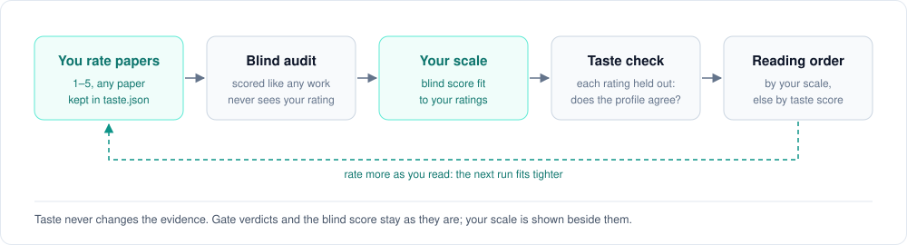

# Taste-Calibrated Research

Give it one paper. It maps the line of work around that paper and judges each work by what it delivers, not by its venue or citation count. It then calibrates that judgement against papers you have read and rated.


## Setup

You need Python 3.9 or newer and no extra packages. Runs bill your Claude or ChatGPT subscription through the official CLI, not an API key.

1. Sign in once with Claude Code (`claude`, then `/login`) or with Codex (`npm i -g @openai/codex`, then `codex login`).
2. Get a free [Semantic Scholar key](https://www.semanticscholar.org/product/api#api-key-form) and set it: `export S2_API_KEY=...` (macOS, Linux) or `setx S2_API_KEY "..."` and a new window (Windows). Without a key, most searches are refused.
3. Optional but recommended: let the tool read full-text PDFs: `brew install poppler` on a Mac, `pip install pypdf` on Windows or Linux. Without one, papers that are not on arXiv as HTML are judged from their abstract.
4. Run `python3 -m tastecal doctor` to check the setup.

## Run

```bash
python3 -m tastecal serve                                      # local page: start runs, rate papers, open reports
python3 -m tastecal run "arXiv:2212.10156" --plan claude-max   # the same run from the command line
python3 -m tastecal resume runs/<run>                          # continue a stopped run; done calls come from the cache
```

Each run writes three files to `runs/<run>/`: `report.html` (opens in any browser), `graph.json` and `run.log`.

| Flag | Default | Effect |
|---|---|---|
| `--plan` | none | `claude-pro`, `claude-max`, `claude-team(-premium)`, `chatgpt-free`, `chatgpt-plus` or `chatgpt-pro`; each sets the CLI tool, model and map size |
| `--budget` | 30 | Number of papers on the map |
| `--scope "autonomous driving"` | none | Lists works from other fields as *borrowed*; they are not mapped |
| `--taste <name>` | your default profile | Taste profile to use |
| `--language zh-CN` | `en` | Report language |
| `--refresh` | off | Fetch search results and citer lists again, however recent the cached copy |
| `--model`, `--effort` | Opus 5.5 or GPT-6 Astra, `high` | Model and reasoning effort |

## The flow

1. **Seed.** The seed can be a title, link, DOI or arXiv ID. `--scope` limits the map to one field.

2. **Grow along problems.** Each work becomes a card with four parts: the problem it starts from, its move, its key insight, and what it leaves open. A ledger tracks the open problems. Each round does two things:
    - It reads references and citing papers through *the sentence that cites them*. It keeps only works that raised a problem or worked on one.
    - It searches for papers on each open problem.

    New problems that restate known ones are merged. Growth stops at the budget, or when new papers mostly repeat known problems.

3. **Synthesize.**
    - Problems are grouped into threads.
    - Each thread is asked "why?" until the answer reaches a root: hardware, math, data, economics or the field's goal.
    - Threads that share a root merge into a driving force.
    - The forces are tested by a backtest: forces rebuilt from earlier work only predict later work, against a baseline without forces, matched blind against later works on and off the map.
    - The step writes the story and *What's next*: active work, open questions and the assumptions most works share.

4. **Judge.** Each paper is read once, from full text where possible. The tool looks in your `./papers` folder, then arXiv, then open-access PDFs, and uses the abstract only as a last resort.
    - **Gates.** Four questions per paper. Does it deliver what it claims? Does it say why it works, and when it would not (quoted, and checked against the text)? Do the gains repeat beyond one setting, and which levers shown in the text could produce them? Did later work build on it or challenge it? Fixed rules turn the answers into a verdict: *solid*, *treasure candidate*, *gain not attributed*, *incremental* or *not delivered*.
    - **Audit.** A blind score of contribution, compared with attention (citations and code-repository stars per year, ranked against every work seen while growing). The scorer sees an evidence pack with no title, authors, venue or counts. A work can be flagged as a *possible hidden gem*, *possibly overhyped* or *safe to skip*. A flag stays only if a judge agrees after hearing an advocate and a critic; a possible gem must also be unnoticed in absolute terms.

5. **Calibrate.** This step matches the scores to your ratings (see the next section).

6. **Report.** One HTML file holds:
    - the mechanism;
    - a transit-style map with side branches folded (works that fail the gates stay in place, drawn dashed);
    - the why-ladders and the story;
    - the verdicts with their evidence;
    - your scale and a reading order.

## Taste calibration



- **Profile.** `taste.json` holds your profiles: a few lines on what you value, plus papers you rated. The rated papers can come from any field (see `taste.example.json`). You can edit the file on the page or by hand. The presets are `practitioner`, `theorist` and `newcomer`.
- **Your scale.** The audit scores your rated papers blind, the same way it scores every work. It then fits the blind score to your ratings. Each work shows its score on your scale next to the blind score, and the report says how often the two put your papers in the same order.
- **Taste check.** This needs at least 3 rated papers. Your profile scores each one with that paper's own rating held out. The report gives the share of pairs it puts in your order, and how far off it is on average. A low share means the profile does not yet capture your taste.
- **Reading order.** Works are ordered by your scale when there is one, and by the taste score otherwise. The profile also picks *treasure candidates*: works that give a reason they should work but are not yet verified. The taste score sees what the careful reading found in each paper, not only its summary card. Until you have rated 8 papers, the report suggests which to rate next.
- **Rate as you read.** Open a report from the page, click a work and give it 1–5. The rating is saved to the profile, and the next run uses it.
- **What taste never touches.** Taste does not change the gate verdicts or the blind score. The gate reader and the blind scorer never see your ratings or your profile.

## Layout

```
tastecal/
  cli.py        commands: run, resume, serve, doctor, assess, gates, render, lint, polish, profiles
  core/         settings, graph model and schema, cached HTTP, model CLIs (llm.py)
  sources/      Semantic Scholar, OpenAlex, web search, full text
  lineage/      grow.py, synthesize.py, outlook.py        steps 1–3
  judge/        gates.py, audit.py, quality.py            step 4
  taste/        profiles.py, calibration.py, presets/     step 5
  report/       polish.py, render.py, report.html         step 6
  prompts/      every prompt, by step
  app/          serve.py, app.html: the local page
tests/          offline tests (fake sources, fake model)
docs/           reference.md, intention.md, taste-template.md, images/
runs/           your runs (git-ignored)
taste.json      your profiles and ratings (git-ignored)
```

## Good to know

- **Billing.** Runs use your plan. API-key settings in your shell are left out of the CLI calls. A usage limit is not an error: the run waits for the reset and then continues. Use `--no-wait` to stop instead.
- **Cache.** Every model reply and HTTP response is cached in `.tastecal_cache/`. Re-runs and `resume` cost nothing for work already done. The prompt text is part of the cache key, so editing a prompt re-runs that step. Search results and citer lists expire after 14 days, so "who cites this" stays current.
- **Gaps.** Downloads that failed (rate limits, network) are listed in `runs/<run>/gaps.json`, and `resume` fetches them again.
- **Tests.** Run `python3 -m unittest discover -s tests`. The tests need no network.
- **More detail.** Every flag, environment variable and rule is in [docs/reference.md](docs/reference.md).
