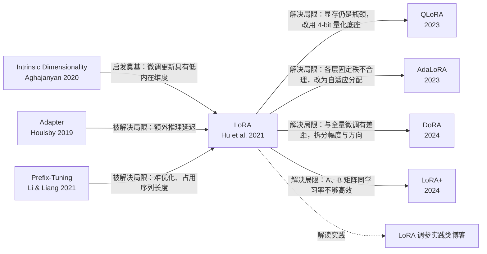

# Taste-Calibrated Research · Intention

> 给定一篇文章，找出它在领域演化中的位置：它从哪里来、解决了谁的问题、又把什么问题留给了谁。
> 再按"它实际交付了什么"而不是名气去评判每篇工作，并用我读过、打过分的文章去校准这个判断——
> 既让阅读贴近自己的审美，也让自己的审美不钻牛角尖。

---

## 1. 为什么要做

每天新出的文章太多，其中不少写得很绕，读完才发现没交付什么。在审美和理解底层逻辑比工程实现更重要的时候，需要一个工具帮自己决定"读什么、按什么顺序读、读的时候该怀疑什么"。

读一篇文章时，我们通常只看到一个"点"：它提出了什么方法、效果有多好。但真正理解它，需要知道它所在的"线"和"面"：

- 它为什么会出现？前人卡在了哪里？
- 它的方法为什么长这样？是在回应谁的局限？
- 它之后，领域往哪走了？它自己的局限被谁解决了？

现有工具解决不了三件事：

1. **说不清关系。** Connected Papers、ResearchRabbit、Litmaps 这类工具基于共引和相似度，能告诉你"哪些文章相关"，但说不清为什么相关、是什么关系，也基本不覆盖博客和技术报告。
2. **说不清贡献。** 引用数、会议、机构说的是关注度，不是贡献。真正的好工作可能没人注意，热门工作也可能主要靠宣传。
3. **说不清自己的偏差。** 只按自己的口味筛，口味会越筛越窄；只按别人的标准读，又读不到自己在意的东西。

所以这个工具要补三层：**演化关系的梳理、与名气分开的贡献判断、以及把自己的审美放到客观判断旁边去对照。**

## 2. 要回答的问题

给定一篇种子文章 A：

**脉络**

1. A 站在谁的肩膀上？它继承了哪些问题，受了哪些工作的启发？
2. A 解决了前人的什么问题？具体是哪篇文章的哪个局限？
3. 谁接过了 A 的问题？A 留下的局限，被哪些后续工作解决、挑战或绕开？
4. 领域的主干和分叉是什么？哪些是关键转折，哪些是并行路线，哪些路线后来被放弃？
5. 推动整条线的根本原因是什么（硬件、数学、数据、经济，或领域本身的目标）？
6. 现在的前沿在哪里？还有哪些问题悬而未决，大多数工作共享了哪些假设？

**判断**

7. 每篇工作是否交付了它宣称的东西？增益是来自它的想法，还是来自别的杠杆（更多输入、不对等的调参、自选的成本比、在指标上训练的组件）？
8. 它是否说清了为什么有效，以及什么时候会失效？
9. 增益能否在单一设置之外重复？后来的工作是在它之上构建，还是挑战了它？
10. 它得到的关注和它的贡献相称吗？哪些可能被埋没，哪些可能被高估？

**品味**

11. 我的打分和与名气无关的盲审判断差在哪里？
12. 我写下的品味描述，能不能复现我自己对文章的打分？
13. 按我的品味，图上哪些"有理由但尚未验证"的工作最值得先读？

## 3. 核心思路

### 3.1 以"问题"为线索串联文章

每篇文章都被提炼成一张卡片：

```
继承的问题  →  做法  →  关键洞见  →  遗留的局限
```

文章之间的关系，本质上是这些卡片之间的咬合：A 的"遗留局限"恰好是 B 的"继承问题"，就构成一条"B 解决了 A 的局限"的边。

遗留的局限进入一本**问题台账**。扩展沿着台账走，而不是沿着原始引用走：

- 读参考文献和引用者时，看的是**引用它的那句话**，只保留提供了问题或洞见、或者对它做了解决、扩展、挑战、竞争、迁移、解读的工作。仅仅"用到了它"的不收。
- 把开放的问题变成搜索，找到解决了问题却没引用提出者的工作，以及博客和技术报告。
- 新问题先去重合并再计数；新收录的工作基本只在重复已知问题时，就停止扩展。

搜索、筛选、连边、叙事，都围绕这个抽象展开。扩展这一步不使用品味。

### 3.2 判断与名气分开

- **关卡（gates）。** 每篇论文尽量从全文读一次，依次回答：宣称与交付是否一致、有没有给出理由（并说明何时失效）、增益是否可重复、领域如何反应。固定规则把答案变成结论：*站得住*、*宝藏候选*、*增益未归因*、*增量工作*、*未交付*。每个结论都要能指回原文。
- **盲审（audit）。** 贡献分来自一个去掉标题、作者、会议和各种计数的证据包；关注度来自每年引用数和代码仓库 star 数，和扩展过程中见过的所有文章比较，而不只和图上的文章比（图上本来都是重要工作，只在图内比会把几百次引用的文章也算成"没人注意"）。两者对比，标出*可能被埋没*、*可能被高估*、*可以跳过*。被标出的工作再经过正方、反方和裁判的复核，裁判同意才保留标记；*可能被埋没*还要在绝对意义上确实少有人引用，并通过一次看引用数据的核对。

### 3.3 品味与判断分开，再放在一起对照

这是这个工具名字的来源。

- **隔离。** 品味不改变关卡结论，也不改变盲审分数。关卡和盲审打分时看不到我的品味描述和我的打分。隔离是单向的：品味打分时可以看到关卡读全文时找到的证据（是否兑现、基线是否公平、显示了哪些杠杆），因为审美往往就是关于证据的，而摘要卡片上没有这些细节。
- **品味的作用。** 品味只决定两件事：哪些"有理由但尚未验证"的工作成为宝藏候选，以及阅读顺序。
- **校准。** 我用一段文字写下自己在意什么、通常跳过什么，再给读过的文章打分（可以来自任何领域）。工具做两件事：
  - **我的尺度**：用同样的盲审给我打过分的文章打分，再把盲审分数拟合到我的打分上，于是每篇工作都有一个"换算到我尺度上的分数"。
  - **品味检验**：留出每篇文章自己的打分，用剩下的品味描述去预测它，报告预测和我的打分在多大比例的文章对上排序一致。
- **一张图。** 报告里有一张"品味 vs 盲审"散点图：横轴盲审贡献分，纵轴品味分，我打过分的文章叠在上面并画出拟合线。左上角是"我喜欢但证据弱"，右下角是"扎实但不合我口味"，旁边列出两边分歧最大的工作。
- **对照的意义。** 两个一致率合在一起是一次诊断：我的品味是否基本等于"交付了什么"；如果不是，我的品味描述是否抓住了这个差别。这就是"让审美不钻牛角尖"的方法——不是把品味变成过滤器，而是让它每次都和一个看不到它的判断放在一起比。
- **闭环。** 在报告里边读边给文章打分，打分写回品味档案，下一次运行就用上。

目前品味只通过 prompt 里的描述和示例起作用（类似 in-context learning），因为调用的是闭源模型。

## 4. 输入与输出

### 输入

- **种子文章**（必需）：标题、论文链接、arXiv ID、DOI 或 Semantic Scholar ID
- **可选约束**：领域范围（其他领域的工作列为*借用*，不进图）、展开规模、报告语言
- **品味档案**（可选）：几行文字描述，加上打过分的文章（标题或链接、0–1 的分数、一句理由）。至少 3 篇才启用校准，8 篇左右、分数拉得开时结果才可信
- **本地全文**（可选）：放在 `./papers` 里的非开放获取文章

### 输出

1. **报告**（单个 HTML 文件）：机制（目标、核心张力、驱动力）、地铁线式脉络图、每条线的"为什么"阶梯、故事、检验、What's next、结论与证据、关注度对贡献的散点图、品味对盲审的散点图、我的尺度和阅读顺序
2. **结构化数据**：`graph.json`，节点、边、问题台账、判断和校准结果，便于复用和二次可视化
3. **运行日志**：`run.log`

### 节点（文章）包含

| 字段 | 说明 |
|---|---|
| 基本信息 | 标题、作者/机构、时间、链接、引用数 |
| 来源类型 | 论文 / 博客 / 技术报告 / 其他 |
| 卡片 | 继承的问题、做法、关键洞见、遗留的局限 |
| 角色 | 种子 / 奠基 / 驱动 / 转折 / 改进 / 分支 / 前沿 / 解读 |
| 判断 | 关卡结论及原文证据、盲审贡献分、关注度、标记 |
| 品味 | 品味打分及理由、换算到我尺度上的分数 |

### 边（关系）包含

| 字段 | 说明 |
|---|---|
| 类型 | 见下表 |
| 一句话说明 | 具体说明"谁对谁做了什么"，而不是泛泛的"相关" |
| 依据 | 原文引用句、实验对比或出处位置 |
| 置信度 | 作者明确声称（stated）/ 根据内容推断（inferred） |

## 5. 关系类型

| 类型 | 代码 | 含义 | 举例 |
|---|---|---|---|
| **解决局限** | `resolves` | B 针对 A 的明确问题提出解决方案 | A 有推理延迟 → B 让增量可合并回原权重 |
| **扩展推广** | `extends` | B 把 A 的框架推广到更一般、更大规模或更多场景 | 单任务 → 多任务；小模型 → 大模型 |
| **启发奠基** | `inspires` | A 提供了 B 的关键洞见或理论动机，但不在同一条问题线上 | 一篇理论分析启发了一种新方法 |
| **质疑反驳** | `challenges` | B 指出 A 的结论、方法或评测存在问题 | 复现失败、反例、评测缺陷 |
| **并行竞争** | `competes` | A 和 B 针对同一问题走了不同路线 | 同期的两种替代方案 |
| **应用迁移** | `applies` | B 把 A 的方法用到新的领域或任务 | NLP 方法迁移到视觉 |
| **解读实践** | `explains` | B 是对 A 的解读、总结或工程经验，本身不提出新方法 | 多为博客、综述 |

**每条边都必须能用一句具体的话说清楚**，说不清的就不连。

## 6. 原则

1. **关系优先于相关。** 语义相似不等于有演化关系。宁可少连，不要乱连。
2. **少而精。** 目标是 15–50 个关键节点构成的清晰脉络，而不是几百篇文章的引用网。剪枝比扩张更重要。
3. **每条边、每个结论都可溯源。** 能回到原文核对；区分"作者自己说的"和"我们推断的"。说不出原文依据的判断，不能把一篇工作折叠掉。
4. **判断不看名气。** 贡献在看不到标题、作者、会议和计数的情况下打分；关注度单独计算，两者只在最后对比。
5. **品味不碰证据。** 品味决定读什么、按什么顺序读，不决定证据怎么判。判断层永远看不到品味。
6. **对不确定诚实。** 只读了摘要的标"未验证"；太新的工作标"为时尚早"；模型可能已经知道答案的回测标为"仅供参考"；同一结论占比过高时提醒判断可能没有区分度。
7. **论文为骨架，博客为血肉。** 论文的引用关系提供可靠骨架；博客、技术报告补充解读、工程实践和行业反应。博客如果开创了某条路线，也可以是主干节点。
8. **可读性优先。** 网状结构也要能一眼看出主干；文字一句一个意思，不用夸奖词。输出是给人读的，不是给机器存的。

## 7. 范围

### 现在做

- 从**单篇**种子文章出发，**双向**展开（前驱 + 后继）
- 混合来源：论文 + 博客 / 技术报告（博客需要网页搜索的 key）
- 带类型、带说明、带依据的关系，以及领域的驱动力
- 每篇工作的关卡判断和贡献/关注度盲审
- 品味档案、我的尺度、品味检验、边读边打分
- 运行在个人已有的 Claude 或 ChatGPT 订阅上，不需要 API key

### 暂时不做

- 多篇种子合并、整个领域的全景地图
- 持续追踪新发表的文章
- 用微调或 LoRA 学习品味（目前只靠 prompt）
- 自动获取非开放获取文章的全文
- 多人协作、产品化（目前定位是**个人研究工具**）

## 8. 怎么算做好了

用几篇我熟悉领域的文章做种子跑一遍，检验：

**脉络**

- **主干正确**：生成的主线与该领域权威综述的叙事基本一致，关键转折没有遗漏
- **关系可信**：随机抽查边，至少 80% 的类型和说明我认可，且能在原文找到依据
- **有增量**：能发现至少几篇我原本不知道、但确实重要的文章
- **读得懂**：看完输出 30 分钟内，能用自己的话讲出该领域的 3–5 个关键转折
- **够精简**：节点数量可控，没有大量凑数的边缘文章

**判断**

- **有区分度**：没有哪个结论覆盖绝大多数工作；抽查被折叠的工作，我认可折叠理由
- **标记可信**：抽查"可能被埋没""可能被高估"，我认可的占多数，而且被埋没的确实少有人引用

**品味**

- **能复现我**：品味检验的排序一致率明显高于随机（0.5）
- **有用**：按阅读顺序读前几篇，我觉得比按引用数读更值得

目前还没有固定的评测集，这是下一步要补的。

## 9. 示意：以 LoRA 为种子

下面是脉络部分期望效果的一个手工示意（仅说明形态，不是最终结果）：



配套叙事大致是：*Adapter 和 Prefix-Tuning 证明了"只调少量参数"可行，但分别带来推理延迟和优化困难；内在维度的研究暗示微调更新本身是低秩的；LoRA 把这两条线合在一起，用可合并的低秩增量同时绕开了两个问题。此后的工作沿着它的局限分成几支：省显存（QLoRA）、更聪明地分配秩（AdaLoRA）、缩小与全量微调的差距（DoRA）、改进优化（LoRA+）……*

在此之上，判断层会给出每个节点是否站得住、贡献和关注度是否相称；品味层会按我的打分给出阅读顺序。

## 10. 已知局限与待决定的问题

### 已经定下的

- **数据源**：Semantic Scholar（引用句、检索）+ OpenAlex（按影响力排序的引用者）+ 可选网页搜索（博客）
- **关系判定**：读引用句判断关系；判断质量时尽量读全文（本地文件 → arXiv → 开放获取 PDF → 摘要）
- **呈现**：单文件 HTML 报告，地铁线式脉络图，按时间排布
- **停止**：达到规模上限，或连续两轮基本只出现已知问题

### 已知局限

- 品味只是 prompt 里的参考（类似 in-context learning）。如果以后换成开源模型，能把更多专家的审美做成 LoRA 会更好。
- 主要读开放获取的文章，不开放的需要自己下载放进 `./papers`。
- LLM 天然关注数字结果和常见的审稿问题，判断的区分度还需要持续检验。
- 新收录的文章缺少后续反应，评价不准。
- 驱动力的回测受模型训练数据影响：截止时间落在模型已知范围内时，结果只能作为参考。

### 待决定的

- **评测集**：选哪几篇种子文章作为固定的检验样例，每次改动后都跑一遍
- **品味的上限**：只靠 prompt 能把品味校准到什么程度，什么时候值得换开源模型做 LoRA
